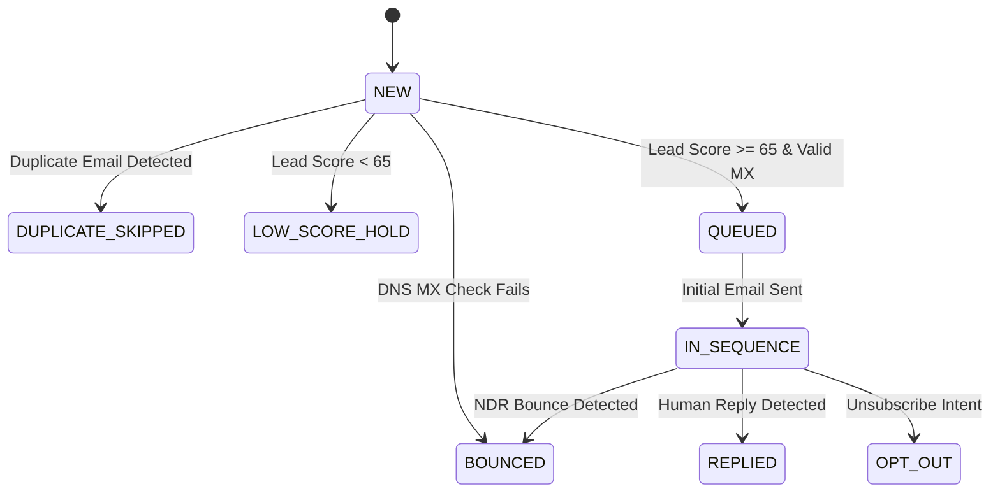
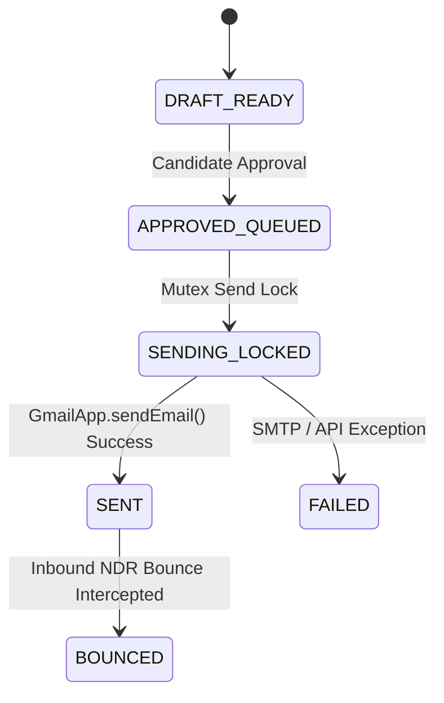
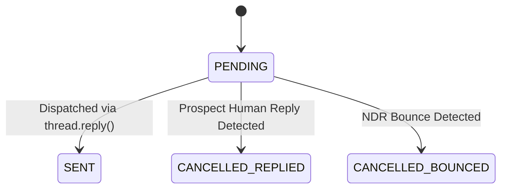

# Single Source of Truth (SSOT)
## Project Antigravity: Architecture, Data Schemas & Operational Contracts

**Document Version:** 1.0.0  
**Status:** Authoritative Master Reference  
**Platform Stack:** Google Apps Script V8 • Google Sheets Relational CRM • Gmail API • Google Drive • Gemini 1.5 Pro REST API • HtmlService Web App  

---

## 1. System Architecture & Component Boundaries

```
+--------------------------------------------------------------------------------------------------+
| CANDIDATE ASSET & PROOF-OF-WORK LAYER (GOOGLE DRIVE)                                             |
| [Master Resume/CV]   [GitHub Repo Index]   [Case Study PDFs]   [Portfolio Links]   [Arch Docs]   |
+------------------------------------------------+-------------------------------------------------+
                                                 | (Drive File IDs & Metadata Indexed)
                                                 v
+--------------------------------------------------------------------------------------------------+
| RELATIONAL DATABASE LAYER (GOOGLE SHEETS - 14 NORMALIZED TABLES)                                 |
| 1. Candidate_Profile     5. Target_Companies    8. Email_Campaigns    11. Responses              |
| 2. Projects              6. Opportunities       9. Outreach_History   12. Interview_Pipeline     |
| 3. Work_Experience       7. Contacts           10. Follow_Ups         13. Notes                  |
| 4. Skills                                                             14. KPI_Metrics            |
| Tab 0: Command_Center (Formula-Driven Scorecards & Pipeline Views)                               |
+------------------------------------------------+-------------------------------------------------+
                                                 | (Batch Arrays / in-memory hash joins)
                                                 v
+--------------------------------------------------------------------------------------------------+
| APPLICATION & ORCHESTRATION LAYER (GOOGLE APPS SCRIPT V8)                                        |
| • 00_Config.js: Platform constants, 14 schemas, persona weights, dynamic spreadsheet resolver    |
| • 00_BootstrapAndMenu.js: Schema generator, column data validations, sample seed records         |
| • 01_ContactManager.js: DNS MX verification, deduplication, 100-point composite lead scoring     |
| • 02_03_CampaignAndPersonalizer.js: Bipartite tag matching, 6 persona template families, UTMs   |
| • 04_05_SchedulerAndFollowUp.js: Quota guard (100/day), atomic lock, thread-locked follow-ups   |
| • 06_07_08_ResponseAndKPIEngine.js: Response polling, bounce interception, sentiment & KPIs      |
| • 09_AiCopilotAndDossier.js: Gemini 1.5 Pro REST bridge & 3-page Google Docs Interview Dossier   |
| • 10_TriggersAndAutomations.js: 15-minute cron schedulers & nightly KPI aggregators              |
| • WebAppController.js: REST/RPC controller serving doGet and client-server API functions         |
+------------------------------------------------+-------------------------------------------------+
                         |                                          |
     (UrlFetchApp HTTPS) v                                          v (HtmlService / Browser)
+----------------------------------------+     +---------------------------------------------------+
| EXTERNAL AI & INTELLIGENCE             |     | STANDALONE WEB APPLICATION UI                     |
| [Gemini 1.5 Pro REST API]              |     | [WebAppUI.html]                                   |
| - Temperature: 0.2                     |     | - Command Center & KPI Telemetry                  |
| - Schema: application/json             |     | - Contacts Table & 100-Point Scorer               |
| - Pain-point extraction & Dossiers     |     | - Campaign Queue & Draft Inspector Drawer         |
+----------------------------------------+     +---------------------------------------------------+
```

---

## 2. 14-Table Relational Database Schema Specifications

### Production Master Profile Reference (Ankit Choudhary)
* **Candidate ID**: `CAND-01`
* **Full Name**: `Ankit Choudhary`
* **Headline Positioning**: `Manufacturing HR Leader | Plant HR, Industrial Relations, Workforce Strategy & Performance Transformation`
* **Total Experience**: `15 Years`
* **Contact & Socials**: `+91 7709693603` • `ankitchoudharymba@gmail.com` • `https://linkedin.com/in/ankit-choudhary-human-resources`
* **Workforce Scale Led**: 3,850 Personnel (2,350 on-roll + 1,500 contract across Steel & Foundry Manufacturing)
* **Core Value Pillars**:
  1. `Plant HR & Industrial Relations Governance (Contract Labour, Wage Settlements, Statutory Compliance)`
  2. `Performance Management Systems (PMS & KRA/KPI Architecture across Managerial & Supervisory Cadre)`
  3. `Integrated HR Technology (In-House Safety, PMS, LMS & Biometric ESSL HRIS Architecture)`

---

### Table 1: `Candidate_Profile`
| Column Name | Data Type | Key / Constraint | Description & Purpose |
|---|---|---|---|
| `candidate_id` | STRING | PK (Not Null) | Unique candidate identifier (e.g., `CAND-01`) |
| `full_name` | STRING | Not Null | Candidate display name used in email signatures |
| `headline_positioning` | STRING | Not Null | Core value-asset positioning statement |
| `years_experience` | NUMBER | Not Null | Total professional experience in years |
| `core_value_pillars` | JSON_ARRAY | Not Null | Top 3 business/technical problems solved |
| `portfolio_base_url` | URL | Not Null | Base portfolio URL for UTM parameter injection |
| `github_profile_url` | URL | Not Null | Candidate primary GitHub profile link |
| `linkedin_url` | URL | Not Null | Public LinkedIn profile URL |
| `master_resume_drive_id`| STRING | Not Null | Google Drive File ID of master CV |
| `calendar_booking_url` | URL | Not Null | Direct scheduling calendar link for email CTAs |
| `daily_send_limit` | INTEGER | Default: 100 | Daily ceiling on outbound dispatches |

### Table 2: `Projects`
| Column Name | Data Type | Key / Constraint | Description & Purpose |
|---|---|---|---|
| `project_id` | STRING | PK (Not Null) | Unique project identifier (e.g., `PRJ-001`) |
| `candidate_id` | STRING | FK &rarr; Table 1 | Links to `Candidate_Profile.candidate_id` |
| `project_title` | STRING | Not Null | Concise business-facing project name |
| `project_type` | ENUM | Not Null | `GITHUB_REPO` \| `CASE_STUDY` \| `LIVE_SAAS` |
| `problem_domain_tags` | CSV_TAGS | Not Null | Matched against opportunity pain tags (e.g., `llm-latency, rag`) |
| `tech_stack_tags` | CSV_TAGS | Not Null | Matched against JD required tech stack |
| `architecture_summary` | TEXT | Not Null | 1-sentence technical implementation description |
| `quantified_business_impact` | STRING | Not Null | Verified numerical ROI metric for email hooks |
| `github_repo_url` | URL | Nullable | Direct URL to public code repository |
| `case_study_url` | URL | Not Null | Deep-dive writeup or benchmark document |
| `target_persona_fit` | ENUM | Not Null | `FOUNDER` \| `CTO` \| `VP_ENG` \| `HIRING_MGR` |

### Table 3: `Work_Experience`
| Column Name | Data Type | Key / Constraint | Description & Purpose |
|---|---|---|---|
| `experience_id` | STRING | PK (Not Null) | Unique career milestone identifier (e.g., `EXP-001`) |
| `candidate_id` | STRING | FK &rarr; Table 1 | Links to `Candidate_Profile.candidate_id` |
| `company_name` | STRING | Not Null | Prior employer name |
| `role_title` | STRING | Not Null | Official professional title held |
| `industry_vertical` | STRING | Not Null | Industry classification for affinity matching |
| `challenge_context` | TEXT | Not Null | Inherited technical bottleneck or organizational challenge |
| `action_executed` | TEXT | Not Null | Specific architectural or strategic intervention executed |
| `roi_metric_statement` | STRING | Not Null | Quantified enterprise business outcome |
| `verification_url` | URL | Nullable | Public engineering blog post or press release link |

### Table 4: `Skills`
| Column Name | Data Type | Key / Constraint | Description & Purpose |
|---|---|---|---|
| `skill_id` | STRING | PK (Not Null) | Unique competency identifier (e.g., `SKL-001`) |
| `skill_name` | STRING | Unique (Not Null) | Canonical technology or skill title |
| `skill_category` | ENUM | Not Null | `BACKEND` \| `AI_ML` \| `INFRA` \| `PRODUCT` \| `GTM` |
| `proficiency_score` | INTEGER | 1 to 10 | Skill weighting multiplier |
| `primary_project_fk` | STRING | FK &rarr; Table 2 | Links to primary proof project |
| `primary_exp_fk` | STRING | FK &rarr; Table 3 | Links to primary work experience milestone |
| `synonym_keywords` | CSV_TAGS | Not Null | Keyword aliases for JD matching |

### Table 5: `Target_Companies`
| Column Name | Data Type | Key / Constraint | Description & Purpose |
|---|---|---|---|
| `company_id` | STRING | PK (Not Null) | Unique company identifier (e.g., `CMP-101`) |
| `company_name` | STRING | Not Null | Clean brand name for email copy |
| `website_domain` | STRING | Unique (Not Null) | Root domain for MX record verification |
| `industry_vertical` | STRING | Not Null | Industry sector |
| `funding_stage_headcount`| STRING | Not Null | Growth indicator (e.g., `Series B ($32M) \| 85 Employees`) |
| `recent_trigger_event` | TEXT | Not Null | News catalyst (funding, product launch, leadership hire) |
| `inferred_pain_points` | CSV_TAGS | Not Null | Extracted technical and operational bottlenecks |
| `company_fit_score` | NUMBER | 0 to 100 | Calculated account qualification priority |
| `careers_page_url` | URL | Not Null | Public careers or job listings link |

### Table 6: `Opportunities`
| Column Name | Data Type | Key / Constraint | Description & Purpose |
|---|---|---|---|
| `opportunity_id` | STRING | PK (Not Null) | Unique role requisition identifier (e.g., `OPP-201`) |
| `company_id` | STRING | FK &rarr; Table 5 | Links to `Target_Companies.company_id` |
| `role_title` | STRING | Not Null | Requisition title |
| `opportunity_type` | ENUM | Not Null | `POSTED_JD` \| `UNPOSTED_EXPANSION` \| `FRACTIONAL` |
| `jd_source_url` | URL | Nullable | Direct URL to public job listing |
| `raw_jd_text` | TEXT | Not Null | Full job description text analyzed by AI |
| `extracted_pain_points` | JSON_ARRAY | Not Null | AI-distilled core bottlenecks |
| `required_skills_tags` | CSV_TAGS | Not Null | Normalized skill tags for matching |
| `matched_project_1_fk` | STRING | FK &rarr; Table 2 | Top-scoring matched candidate project |
| `custom_roi_hypothesis` | TEXT | Not Null | Synthesized 1-sentence value proposition |

### Table 7: `Contacts`
| Column Name | Data Type | Key / Constraint | Description & Purpose |
|---|---|---|---|
| `contact_id` | STRING | PK (Not Null) | Unique contact identifier (e.g., `CNT-501`) |
| `company_id` | STRING | FK &rarr; Table 5 | Links to `Target_Companies.company_id` |
| `opportunity_id` | STRING | FK &rarr; Table 6 | Links to `Opportunities.opportunity_id` |
| `first_name` | STRING | Not Null | Salutation token |
| `last_name` | STRING | Not Null | Full family name |
| `email_address` | EMAIL | Unique (Not Null) | Primary verified recipient email |
| `verification_status` | ENUM | Not Null | `VERIFIED_VALID` \| `CATCH_ALL` \| `INVALID` |
| `persona_type` | ENUM | Not Null | `FOUNDER` \| `HIRING_MGR` \| `TECH_LEAD` \| `RECRUITER` \| `PEER` |
| `role_title` | STRING | Not Null | Exact title of decision maker |
| `linkedin_url` | URL | Not Null | Public LinkedIn profile URL |
| `timezone_offset` | STRING | Not Null | IANA timezone string (e.g., `America/Los_Angeles`) |
| `lead_score` | INTEGER | 0 to 100 | Dynamic composite score |
| `outreach_status` | ENUM | Not Null | `NEW` \| `QUEUED` \| `IN_SEQUENCE` \| `REPLIED` \| `OPT_OUT` \| `BOUNCED` |

### Table 8: `Email_Campaigns`
| Column Name | Data Type | Key / Constraint | Description & Purpose |
|---|---|---|---|
| `campaign_id` | STRING | PK (Not Null) | Unique campaign identifier (e.g., `CMPG-01`) |
| `campaign_name` | STRING | Not Null | Descriptive cohort label |
| `target_persona` | ENUM | Not Null | Maps to template family |
| `template_family_id` | STRING | Not Null | Identifier of blueprint template |
| `daily_cap_allocation` | INTEGER | Not Null | Proportion of 100/day quota assigned |
| `send_window_start_hr` | INTEGER | 0 to 23 | Earliest send hour in prospect local timezone |
| `send_window_end_hr` | INTEGER | 0 to 23 | Latest send hour in prospect local timezone |
| `followup_1_delay_days`| INTEGER | Not Null | Business days before Stage 1 follow-up |
| `followup_2_delay_days`| INTEGER | Not Null | Business days before Stage 2 follow-up |
| `campaign_status` | ENUM | Not Null | `ACTIVE` \| `PAUSED` \| `COMPLETED` |

### Table 9: `Outreach_History`
| Column Name | Data Type | Key / Constraint | Description & Purpose |
|---|---|---|---|
| `outreach_id` | STRING | PK (Not Null) | Unique dispatch log identifier (e.g., `OUT-9001`) |
| `campaign_id` | STRING | FK &rarr; Table 8 | Links to `Email_Campaigns.campaign_id` |
| `contact_id` | STRING | FK &rarr; Table 7 | Links to `Contacts.contact_id` |
| `opportunity_id` | STRING | FK &rarr; Table 6 | Links to `Opportunities.opportunity_id` |
| `matched_project_id` | STRING | FK &rarr; Table 2 | Links to `Projects.project_id` |
| `subject_line` | STRING | Not Null | Rendered personalized subject line |
| `email_body_html` | HTML_TEXT | Not Null | Rendered personalized HTML body |
| `scheduled_send_at` | DATETIME | ISO 8601 | Target dispatch timestamp |
| `actual_sent_at` | DATETIME | Nullable | Dispatched timestamp populated by GmailApp |
| `gmail_thread_id` | STRING | Indexed | Critical thread ID for inline follow-ups |
| `gmail_message_id` | STRING | Nullable | RFC 2822 Message-ID header |
| `dispatch_status` | ENUM | Not Null | `DRAFT_READY` \| `APPROVED_QUEUED` \| `SENDING_LOCKED` \| `SENT` \| `BOUNCED` \| `FAILED` |

### Table 10: `Follow_Ups`
| Column Name | Data Type | Key / Constraint | Description & Purpose |
|---|---|---|---|
| `followup_id` | STRING | PK (Not Null) | Unique follow-up task identifier (e.g., `FUP-3001`) |
| `outreach_id` | STRING | FK &rarr; Table 9 | Parent initial outreach email |
| `contact_id` | STRING | FK &rarr; Table 7 | Recipient contact ID |
| `gmail_thread_id` | STRING | Not Null | Thread ID for thread-locked inline replies |
| `step_number` | INTEGER | 1 \| 2 \| 3 | Sequence stage number |
| `followup_angle` | ENUM | Not Null | `ARCHITECTURE_DIAGRAM` \| `CASE_STUDY_DROP` \| `SOFT_BREAKUP` |
| `followup_body_html` | HTML_TEXT | Not Null | Pre-rendered inline HTML body |
| `scheduled_for` | DATETIME | ISO 8601 | Calculated send date (skipping weekends) |
| `sent_at` | DATETIME | Nullable | Actual dispatch timestamp |
| `followup_status` | ENUM | Not Null | `PENDING` \| `SENT` \| `CANCELLED_REPLIED` \| `CANCELLED_BOUNCED` |

### Table 11: `Responses`
| Column Name | Data Type | Key / Constraint | Description & Purpose |
|---|---|---|---|
| `response_id` | STRING | PK (Not Null) | Unique inbound response identifier (e.g., `RSP-701`) |
| `outreach_id` | STRING | FK &rarr; Table 9 | Parent outreach email ID |
| `contact_id` | STRING | FK &rarr; Table 7 | Responding contact ID |
| `gmail_thread_id` | STRING | Not Null | Associated Gmail thread ID |
| `received_at` | DATETIME | Not Null | Response timestamp |
| `reply_snippet` | TEXT | Not Null | Cleaned plain-text message snippet |
| `sentiment_category` | ENUM | Not Null | `POSITIVE_INTERVIEW` \| `REFERRAL_FORWARD` \| `OOO_AUTO` \| `NOT_NOW` \| `UNSUBSCRIBE` |
| `time_to_reply_hours` | NUMBER | Not Null | Hours elapsed between sent touchpoint and reply |
| `action_required` | BOOLEAN | Not Null | Flags warm lead on Command Center (`TRUE` / `FALSE`) |

### Table 12: `Interview_Pipeline`
| Column Name | Data Type | Key / Constraint | Description & Purpose |
|---|---|---|---|
| `pipeline_id` | STRING | PK (Not Null) | Unique active deal identifier (e.g., `PIP-401`) |
| `company_id` | STRING | FK &rarr; Table 5 | Links to `Target_Companies.company_id` |
| `opportunity_id` | STRING | FK &rarr; Table 6 | Links to `Opportunities.opportunity_id` |
| `primary_contact_id` | STRING | FK &rarr; Table 7 | Hiring Manager / Contact ID |
| `current_stage` | ENUM | Not Null | `1_INTRO_CALL` \| `2_TECH_SCREEN` \| `3_SYSTEM_DESIGN` \| `4_EXEC_FINAL` \| `5_OFFER` \| `CLOSED` |
| `next_meeting_datetime`| DATETIME | Nullable | Scheduled meeting timestamp |
| `prep_doc_drive_url` | URL | Nullable | Auto-generated AI Google Docs Interview Dossier URL |
| `comp_target_range` | STRING | Nullable | Target compensation range |
| `win_probability_pct`| NUMBER | 0 to 100 | Weighted conversion probability |

### Table 13: `Notes`
| Column Name | Data Type | Key / Constraint | Description & Purpose |
|---|---|---|---|
| `note_id` | STRING | PK (Not Null) | Unique note identifier (e.g., `NTE-101`) |
| `entity_type` | ENUM | Not Null | Polymorphic parent type: `COMPANY` \| `CONTACT` \| `PIPELINE` |
| `entity_fk_id` | STRING | FK (Polymorphic) | Target foreign key ID |
| `created_at` | DATETIME | Not Null | Note creation timestamp |
| `note_author` | ENUM | Not Null | `CANDIDATE` \| `AI_COPILOT` |
| `note_content` | TEXT | Not Null | Meeting notes, interview observations, or research details |

### Table 14: `KPI_Metrics`
| Column Name | Data Type | Key / Constraint | Description & Purpose |
|---|---|---|---|
| `metric_date` | DATE | PK (YYYY-MM-DD) | Snapshot date grain |
| `initial_emails_sent` | INTEGER | Not Null | Count of Stage-0 initial emails sent on date |
| `followup_emails_sent`| INTEGER | Not Null | Count of follow-up emails sent on date |
| `total_emails_sent` | INTEGER | Not Null (Max 100) | Sum of initial + follow-up emails sent |
| `bounces_detected` | INTEGER | Not Null | NDR bounce count detected on date |
| `total_replies_received`| INTEGER | Not Null | All human replies received on date |
| `positive_replies_count`| INTEGER | Not Null | Replies classified as `POSITIVE_INTERVIEW` or `REFERRAL_FORWARD` |
| `interviews_booked_count`| INTEGER| Not Null | Deals entered into `Interview_Pipeline` |
| `rolling_7d_reply_rate` | PERCENT | Not Null | 7-day rolling average reply rate |
| `top_performing_project_fk`| STRING | FK &rarr; Table 2 | Candidate project yielding highest positive replies |

---

## 3. 100-Point Deterministic Lead Scoring Model

```
Total_Lead_Score = Min(100, Persona_Score + Stack_Score + Urgency_Score + Verification_Score + Base_Fit)
```

1. **Persona Authority (Max 20 pts)**:
   * `FOUNDER` / `CEO` (<150 emp) = 20 pts
   * `HIRING_MGR` / `VP Eng` / `Director` = 18 pts
   * `TECH_LEAD` / `Staff Engineer` = 16 pts
   * `RECRUITER` / `Talent Partner` = 12 pts
   * `PEER` = 10 pts
2. **Project & Stack Overlap (Max 25 pts)**:
   * 5 points per overlapping tag between `Opportunities.required_skills_tags` and `Projects.tech_stack_tags` (capped at 25 pts).
3. **Company Trigger Urgency (Max 15 pts)**:
   * Active JD posted < 7 days ago or funding announced < 60 days ago = 15 pts
   * JD posted 8–21 days ago = 10 pts
   * Unposted expansion hypothesis = 8 pts
4. **Email Verification Confidence (Max 10 pts)**:
   * `VERIFIED_VALID` (DNS MX confirmed) = 10 pts
   * `CATCH_ALL` = 0 pts
   * `INVALID` = 0 pts (Status set to `BOUNCED`)
5. **Base Dynamic Fit**:
   * Baseline allocation = 15 pts
   * Positive behavioral bonus: +30 pts upon positive reply received; +15 pts upon UTM link click.

**Routing Threshold**:
* `Score >= 65`: Outreach status set to `QUEUED` (eligible for campaign drafting).
* `Score < 65`: Outreach status set to `LOW_SCORE_HOLD`.

---

## 4. Bipartite Tag Intersection Matching Algorithm

```
Match_Score(Project_i, Opp_j) = (2.0 * |Pain_Tags_i ∩ Pain_Tags_j|) + (1.2 * |Tech_Tags_i ∩ Tech_Tags_j|) + Persona_Bonus
```
* **Pain Tag Intersect (Weight 2.0x)**: Matches candidate project problem tags against company bottlenecks.
* **Tech Tag Intersect (Weight 1.2x)**: Matches required JD skills against candidate project tech stack.
* **Persona Bonus (+1.0 pt)**: Added if `Projects.target_persona_fit` directly matches the contact's persona.

---

## 5. State Machine & Status Lifecycles

### Contact Status Lifecycle (`Contacts.outreach_status`)


### Outreach Dispatch Lifecycle (`Outreach_History.dispatch_status`)


### Follow-Up Lifecycle (`Follow_Ups.followup_status`)


---

## 6. Quota Management, Pacing & Anti-Spam Guardrails

* **Daily Outbound Send Limit**: 100 emails/day maximum (Initial + Follow-ups combined).
* **Safety Quota Buffer**: Execution halts immediately if `MailApp.getRemainingDailyQuota() <= 15`.
* **Execution Ceiling**: Maximum 8 emails dispatched per 15-minute trigger run to guarantee execution under 240 seconds.
* **Anti-Collision Guard**: Maximum 2 contacts per target company domain per 7-day rolling window.
* **Staggered Scheduling**: Scheduled send slots are separated by 7-minute increments during prospect business hours (08:00–17:00), automatically rolling weekend timestamps forward to Monday morning.
* **Automated Circuit Breaker**: If `bounces_detected` in `KPI_Metrics` reaches 3 on any single day, all active campaigns immediately switch to `PAUSED`.
